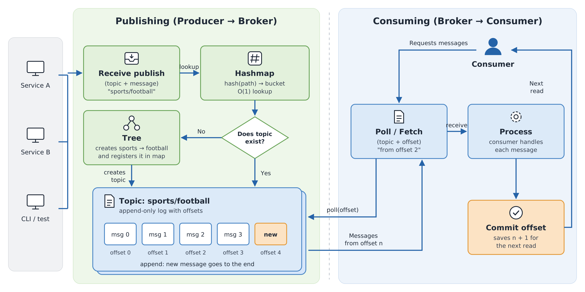

# 🌳 treenity
> A Kafka-style message queue written in Go, where producers and consumers talk to a server through named pipes (FIFOs).



## Description

**treenity** is a Kafka-style message queue written in Go. A **server** keeps named topics as append-only logs in memory; **producers** append messages to them; **consumers** subscribe, receive the messages whose key matches their prefix, and commit their offset so they can disconnect and resume exactly where they left off.

Clients and server are separate processes that talk only through **named pipes (FIFOs)** — no sockets, no external libraries.

---

## ✨ What it covers

- Topics as append-only logs with sequential 32-bit offsets
- Committed offsets: consumers acknowledge each message and resume after reconnecting
- Prefix filtering through a trie, with `--offset` to replay or skip messages
- Text (`key:body`) and binary (`--raw`, little-endian) message formats
- One delivery goroutine per topic: ordered delivery, producers never wait for consumers
- A custom hashmap with chaining for the client index
- Graceful shutdown: every consumer exits with code 0 and every FIFO is removed

---

## 🚀 Instructions

```bash
make            # build ./server and ./client
make test       # run the unit tests
make clean      # remove the binaries   ·   make re: rebuild
```

The server prints its IPC identifier, which depends on its PID; pass that path to the client. Messages are read from stdin, one `key:body` per line. The server logs every request to stderr.

```bash
./server                                    # prints e.g. /tmp/kafka.server.1337
IPC=/tmp/kafka.server.1337                  # use the path your server printed

./client $IPC create user_events            # topic created
./client $IPC subscribe user_events client0 --prefix user.create &
echo 'user.create:{"user":"reach"}' | ./client $IPC produce user_events
./client $IPC info client0
# {"client":"client0","topic":"user_events","offset":1,"prefix":"user.create","ipc":"/tmp/kafka.server.1337.client0"}
```

| Command | Description |
|---------|-------------|
| `create <topic>` · `list` | Manage topics |
| `produce <topic> [--raw]` | Send the messages read from stdin |
| `subscribe <topic> <name> [--prefix p] [--offset n] [--raw]` | Consume until interrupted |
| `info <name>` | A client's metadata as JSON |

Exit codes: `0` success · `1` invalid arguments or connection failure · `2` topic or client error · `3` IPC error.

---

## 🏗️ Architecture

```
 client ──► /tmp/kafka.server.1337 ──► serve loop ──► Broker ──► topics / clients (hashmaps)
   ▲                                                    │
   ├──── <ipc>.<pid>    ◄── answers                     │ wake
   └──── <ipc>.<name>   ◄── messages ◄── delivery goroutine (one per topic)
```

| Goroutine | Role |
|-----------|------|
| `serve` | Reads every request from the main FIFO and answers it |
| `Topic.run` (**one per topic**) | The only writer to the topic's consumers; delivers in offset order |
| `main` | Waits for `SIGINT`/`SIGTERM` and runs the shutdown |

**Synchronization.** A `sync.RWMutex` guards the broker's hashmaps and client metadata; a `sync.Mutex` per topic guards its messages and trie. Locks are always taken broker first, then topic, and never held while writing to a FIFO. The delivery goroutine receives work through channels (`wake` for new messages, `control` for consumers that attach, leave or must say goodbye).

**Guarantees.** Messages from one producer are stored in order; each consumer gets them in offset order, at least once. A consumer that stops reading is dropped after 2 s instead of stalling its topic.

**Shutdown.** The server stops accepting clients, waits up to 5 s for pending commits, sends `BYE` to every consumer and removes all its FIFOs.

---

## 🔌 IPC Choice

Named pipes are supported directly by Go's standard library (`syscall.Mkfifo`), while message queues would need CGo; and a file path makes a natural IPC identifier, named after the server's PID so several servers can run side by side.

A FIFO only goes one way, so communication uses up to three per client: the server's **main FIFO** for requests, a **reply FIFO** (`<ipc>.<pid>`) for answers, and a **consumer FIFO** (`<ipc>.<name>`) for deliveries. Blocking opens are avoided with `O_RDWR` and `O_NONBLOCK`, and requests stay under `PIPE_BUF` (4096 bytes) so concurrent writes never interleave.

---

## 🧩 Data Structures

| Structure | Used for | Why |
|-----------|----------|-----|
| **Hashmap** — FNV-1a, separate chaining, generic `Index[T]` | Client metadata and topics, by name | O(1) exact lookups; stdlib maps are not allowed for client metadata |
| **Trie** — one edge per byte | Consumers, by key prefix | `Match(key)` walks the key once and collects every matching prefix, whatever the number of consumers |

Consumers with an empty prefix match everything, so they skip the trie and go to a plain list.

---

## 🧪 Testing

```bash
make test             # or: go test -race ./...
```

The prefix-matching tests cover exact, partial and non-matches, the empty prefix, edge cases, a large-scale run (5 000 subscribers × 2 000 keys checked against a brute-force scan) and the full filtering through the broker with mixed prefixes. Broker tests use a fake channel, so delivery, offsets and shutdown are tested without FIFOs.

---

## 📁 Project Structure

```
treenity/
├── cmd/
│   ├── server/        # request loop, consumer channel, shutdown
│   └── client/        # session, produce, subscribe
├── internal/
│   ├── broker/        # topics, clients, delivery goroutine
│   ├── hashmap/       # custom hashmap
│   ├── trie/          # prefix trie
│   ├── protocol/      # wire format, validation
│   └── ipc/           # FIFOs
└── Makefile
```

---

## 📋 Requirements

- Go ≥ 1.26
- Linux or macOS (POSIX named pipes)
- `make`

---

## 📚 Resources

- [Apache Kafka — Introduction](https://kafka.apache.org/intro)
- [`fifo(7)`](https://man7.org/linux/man-pages/man7/fifo.7.html) and [`pipe(7)`](https://man7.org/linux/man-pages/man7/pipe.7.html) — FIFO semantics and `PIPE_BUF`
- [The Go Memory Model](https://go.dev/ref/mem) · [Data Race Detector](https://go.dev/doc/articles/race_detector)
- [Trie — Wikipedia](https://en.wikipedia.org/wiki/Trie)

**AI usage.** An AI assistant (Claude) was used as a tutor and pair programmer: to explain FIFOs, Go concurrency and Kafka concepts; to review code and errors against the subject; and to draft parts of the implementation and tests — notably the client session, the stdin producer, the delivery goroutine, shutdown and raw mode — which were then reviewed, tested end to end and discussed until understood.
